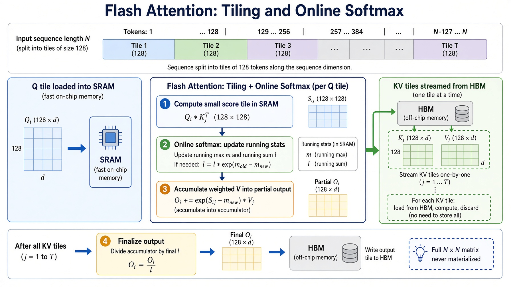

# Flash Attention Explained: From Origin to Low-Level Tiling

**Flash Attention** is an exact, IO-aware algorithm that computes the same attention as the standard transformer formula but does so far more efficiently on GPUs. It never materializes the full $N \times N$ attention matrix, reducing memory traffic from quadratic to near-linear in sequence length.

This post covers the origin of the idea, the role of Tensor Cores, the high-level algorithm, a detailed low-level walk-through of one query tile, the online softmax mathematics, and measured performance.

## Origin and the Paper

Standard self-attention has time and memory complexity $O(N^2)$ in sequence length $N$. Approximate methods tried to reduce the asymptotic complexity but often failed to deliver real wall-clock speedups because they ignored the GPU memory hierarchy.

In May 2022, Tri Dao, Daniel Y. Fu, Stefano Ermon, Atri Rudra, and Christopher Ré published the paper *FlashAttention: Fast and Memory-Efficient Exact Attention with IO-Awareness* (arXiv:2205.14135). It was later presented at NeurIPS 2022. The key insight was to make the algorithm *IO-aware*: explicitly account for data movement between slow high-bandwidth memory (HBM) and fast on-chip SRAM. By tiling the computation and using an online softmax, FlashAttention computes exact attention while moving far less data.

## What Are Tensor Cores?

NVIDIA introduced **Tensor Cores** with the Volta architecture in 2017 (Tesla V100). A Tensor Core is a specialized matrix-multiply-accumulate unit that computes

$$
D = A \times B + C
$$

on small tiles (originally $4 \times 4$ in half precision) in a single instruction. Later generations (Ampere, Hopper, Blackwell) expanded the tile sizes and supported more precisions (TF32, BF16, FP8, etc.).

**Purpose**: The vast majority of compute in deep learning is matrix multiplication. Tensor Cores deliver dramatically higher throughput for these operations than ordinary CUDA cores while using less power. Flash Attention is carefully written so that its small score and value tiles map efficiently onto Tensor Core instructions, which is one reason the algorithm runs so fast once the data is in SRAM.

## High-Level Flow

1. Split the sequence into tiles of size $B$ (typically 64 or 128).
2. For each query tile:
   - Load the query tile into SRAM.
   - Stream every key/value tile from HBM.
   - Compute local scores, update running statistics, and accumulate the weighted values—all inside SRAM.
   - After the last key/value tile, normalize the accumulator by the final sum and write the output tile back to HBM.
3. Move to the next query tile.

The full $N \times N$ matrix is never written to HBM.

## Low-Level Flow: Processing One Query Tile

Consider a query tile of 128 rows (tokens) by $d$ columns (head dimension).

### Step A — Load the Q tile

The GPU copies rows $1$–$128$ of $Q$ from HBM into SRAM. This tile stays resident until every key/value block has been processed against it.

### Step B — Stream KV tiles

For $j = 1, 2, \ldots$ until the end of the sequence:

1. Load the next KV tile (rows of $K$ and $V$, also size 128 by $d$) from HBM into SRAM.
2. Compute the local score tile entirely in SRAM:

$$
S = Q_{tile} K_{tile}^T \quad (128 \times 128)
$$

3. Update the online softmax statistics $m$ and $l$ for each of the 128 query rows (details below).
4. Weight the corresponding rows of $V$ by the current (un-normalized) exponentials and add the result into a partial output accumulator that also lives in SRAM.
5. Discard the current KV tile.

### Step C — Finalize the Q tile

After the last KV tile:

$$
output\ tile = \frac{accumulator}{l}
$$

Write the finished $128 \times d$ output tile to HBM, then free the Q tile from SRAM.

### Step D — Next Q tile

Load rows $129$–$256$ of $Q$ into SRAM and repeat Steps B–C. Continue until the entire sequence is covered.

## Online Softmax Mathematics

For each query row we keep only two running values:

- $m$: maximum score seen so far
- $l$: sum of exponentials of the scores, relative to the current maximum

When a new block of scores arrives:

- Let $m_{new} = \max(m_{old}, \text{max score in new block})$.
- If $m_{new} > m_{old}$, rescale the old sum:

$$
l \leftarrow l \cdot e^{m_{old} - m_{new}}
$$

- Set $m \leftarrow m_{new}$ and add the new block’s exponentials (shifted by the new maximum).

This keeps the representation exact while using constant extra memory.

### Numeric Example

One query row, two blocks:

- Block 1 scores: $2.0, 1.0$
- Block 2 scores: $3.0, 0.5$

**After Block 1**

- $m = 2.0$
- Shifted exponentials: $e^{0} + e^{-1} \approx 1.368$
- $l = 1.368$

**During Block 2**

- New max = 3.0, so rescale:

$$
l \leftarrow 1.368 \times e^{2.0 - 3.0} \approx 0.503
$$

- New block contribution (shifted by 3.0): $e^{0} + e^{-2.5} \approx 1.082$
- Final $l = 0.503 + 1.082 = 1.585$

This matches a normal softmax computed over all four scores at once. The final division by $l$ occurs only after the last block.

## Performance and Complexity

| Aspect                  | Standard Attention | Flash Attention                  |
|-------------------------|--------------------|----------------------------------|
| Attention matrix memory | O(N²)              | O(N) (only block-sized tiles)    |
| HBM traffic             | O(N²)              | O(N² d² / M) (M = SRAM size)     |
| FLOPs                   | O(N² d)            | O(N² d) (identical)              |
| Typical wall-clock      | Baseline           | 2–4× faster on long sequences    |

Because modern GPUs are memory-bandwidth bound for attention, reducing HBM traffic yields large speedups even though the arithmetic count stays the same. The original paper reported roughly 3× speedup on GPT-2 (sequence length 1K) and 2.4× on longer-range tasks. Later versions (FlashAttention-2 and -3) push efficiency higher still by improving parallelism and utilizing newer Tensor Core features.

## Summary

Flash Attention shows that careful attention to the GPU memory hierarchy can turn a theoretically quadratic algorithm into a practical, exact, and much faster implementation. The combination of tiling, online softmax, and Tensor Core-friendly tiles is what makes long-context transformers feasible today.

---

*Primary reference: Dao et al., “FlashAttention: Fast and Memory-Efficient Exact Attention with IO-Awareness,” arXiv:2205.14135, 2022 (NeurIPS 2022).*
