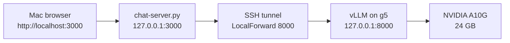

# vLLM on AWS EC2: launch runbook

**For:** Anand (and anyone following the same path a month later)
**Updated:** November 23, 2026 (America/Los_Angeles)
**What this is:** the end-to-end story of bringing up vLLM on a g5.xlarge (A10G) in a custom VPC, then chatting with it from a Mac browser. Commands, networking, and the errors we actually hit.

The scripts in this folder do the install and the serve. This runbook covers what the scripts cannot: the AWS setup, why the "build cheap, run on GPU" split exists, and the fixes for problems we ran into. Script flags and defaults are summarized here; the source of truth is the scripts themselves.

| File | Role |
|---|---|
| [setup-vllm.sh](./setup-vllm.sh) | Run once on a cheap x86 build box. Installs vLLM into `~/vllm-env` and copies the serve script to `~/bin`. |
| [serve-vllm.sh](./serve-vllm.sh) | Run on the g5. Starts `vllm serve` in a tmux session bound to `127.0.0.1`. |
| [chat-ui/chat-server.py](./chat-ui/chat-server.py) + [chat-ui/chat.html](./chat-ui/chat.html) | Run on your Mac. Serves a small chat page and proxies `/v1` to the tunneled vLLM port. |
| [README.md](./README.md) | One-page command cheatsheet. |

This run used Amazon Linux 2023 on the Deep Learning Base OSS Nvidia Driver GPU AMI, SSH user `ec2-user`, key `inference-first.pem`, VPC `inference-vpc` (`10.0.0.0/16`). The working GPU instance was `ip-10-0-1-77`. Ubuntu DLAMIs work the same way; the SSH user is `ubuntu` instead.

---

## Contents

1. [Overview](#1-overview)
2. [Strategy: build cheap, run on GPU](#2-strategy-build-cheap-run-on-gpu)
3. [Network setup](#3-network-setup)
4. [SSH](#4-ssh)
5. [Build box](#5-build-box)
6. [Create an AMI and launch the g5](#6-create-an-ami-and-launch-the-g5)
7. [Serve](#7-serve)
8. [Validate](#8-validate)
9. [Chat in the browser](#9-chat-in-the-browser)
10. [Troubleshooting](#10-troubleshooting)
11. [Shutdown and cost hygiene](#11-shutdown-and-cost-hygiene)
12. [Next steps](#12-next-steps)

---

## 1. Overview

vLLM never listens on the public internet. It binds to `127.0.0.1:8000` on the g5. Your Mac reaches it through an SSH tunnel. A tiny local Python server serves the chat page and forwards `/v1` to that tunnel, so the browser stays same-origin and you do not fight CORS.



Why this shape: a security group that opens port 8000 to the world would expose the model API. Opening only port 22 to your own IP, and tunneling, is enough.

---

## 2. Strategy: build cheap, run on GPU

Installing vLLM (wheels, a venv, optional source checkout) does not need a GPU, but it does take time. Doing that work on a g5 wastes about a dollar an hour. The cheaper path:

1. Launch a small **x86** CPU box (t3a.large is plenty) from the **Deep Learning Base OSS Nvidia Driver GPU AMI**.
2. Size the root volume at about **100 GB**. A 30 GB disk fills up during the install.
3. Run [setup-vllm.sh](./setup-vllm.sh), then **Create image** (an AMI, not just a snapshot). Image creation takes about 5 to 15 minutes.
4. Launch a **g5.xlarge** from that AMI. The NVIDIA driver is already on the DLAMI, so `nvidia-smi` works on first boot. The venv and (after the first download) the model weights live on the EBS volume and survive a stop/start.

Two constraints that are easy to get wrong:

- **x86 only, not Graviton.** A g5 is x86 (AMD EPYC + A10G). An AMI built on ARM (`t4g`, `c7g`, and other Graviton types) will not boot on it. [setup-vllm.sh](./setup-vllm.sh) exits if it detects `aarch64`.
- **Start from the Deep Learning Base OSS Nvidia Driver GPU AMI**, not a stock Amazon Linux or Ubuntu image. That AMI already has the NVIDIA driver and CUDA. Do not hand-install the driver. `setup-vllm.sh` will also refuse to run on ARM, but it cannot fix a missing driver on a stock AMI.

Approximate **us-east-1 on-demand** prices. These move; confirm on the [AWS pricing pages](https://aws.amazon.com/ec2/pricing/on-demand/) before you care about the exact bill.

| Item | Approx. cost | Notes |
|---|---|---|
| t3a.large | ~$0.075 / hour | Build box. Stop or terminate it after the AMI is created. |
| g5.xlarge | ~$1.006 / hour | 1× A10G, 24 GB. This is the expensive line. Stop it when you are not serving. |
| Public IPv4 | ~$0.005 / hour | Charged for auto-assigned public IPs and Elastic IPs. |
| EBS gp3 | ~$0.08 / GB-month | You still pay for the disk while the instance is stopped. 100 GB is about $8 / month. |
| AMI / snapshot storage | ~$0.05 / GB-month | Charged until you deregister the AMI **and** delete its snapshots. |

A Spot g5 is cheaper, but AWS can reclaim it with a two-minute notice. For a first bring-up, on-demand is simpler. See [section 11](#11-shutdown-and-cost-hygiene).

---

## 3. Network setup

This run used a custom VPC named `inference-vpc`. AWS accepts IPv4 CIDRs from `/16` down to `/28`. `10.0.0.0/16` is valid.

A custom VPC does not get internet access for free. You need all four of these, or SSH will have nothing to connect to:

| Piece | Setting | Why it exists |
|---|---|---|
| VPC | `10.0.0.0/16` | Private address space for the project. |
| Subnet | Public subnet, for example `10.0.1.0/24` | Where the instance lands. |
| Internet gateway | Created and **attached** to the VPC | Without the attach, the IGW does nothing. |
| Route table | `0.0.0.0/0` → the internet gateway | How the subnet reaches the internet. |
| Subnet option | **Auto-assign public IPv4 address = Yes** | This is applied **only at launch**. A stop/start will not add a public IP to an instance that launched without one. The alternative is an Elastic IP, which you associate after launch. |

Security group: allow **SSH (port 22) from My IP**, as a `/32` (a single address). Refresh it if your home IP changes. **Do not open port 8000.** Reach vLLM through the SSH tunnel in [section 4](#4-ssh).

To confirm the IGW and route after the fact: VPC console → Internet gateways (state should be attached to `inference-vpc`) → Route tables for the subnet (a default route to `igw-…`).

---

## 4. SSH

On your Mac, lock down the key and add a `Host` entry so you do not have to type the flags every time.

```bash
chmod 400 ~/.ssh/inference-first.pem
```

`~/.ssh/config`:

```
Host inference-g5
  HostName <public-ip>
  User ec2-user
  IdentityFile ~/.ssh/inference-first.pem
  IdentitiesOnly yes
  LocalForward 8000 localhost:8000
```

Then `ssh inference-g5` opens the shell and the tunnel together. Change `HostName` when the public IP changes (it will, after a stop/start, unless you use an Elastic IP).

The username depends on the AMI:

| AMI family | SSH user |
|---|---|
| Amazon Linux 2023 (this run) | `ec2-user` |
| Ubuntu (including Ubuntu DLAMIs) | `ubuntu` |

`Permission denied (publickey,gssapi-…)` with the right key is almost always the wrong username. Try the other one before you regenerate a key.

---

## 5. Build box

Launch a t3a.large (x86) from the Deep Learning Base OSS Nvidia Driver GPU AMI, in the public subnet, with the security group above, auto-assign public IPv4 on, and a **100 GB** root volume if you can set it at launch. If you launched with 30 GB, grow it before you install (see below).

Copy **both** scripts into the same directory on the instance. `setup-vllm.sh` looks next to itself for `serve-vllm.sh` and installs it at `~/bin/serve-vllm.sh`.

```bash
scp -i ~/.ssh/inference-first.pem setup-vllm.sh serve-vllm.sh ec2-user@<build-ip>:~
ssh -i ~/.ssh/inference-first.pem ec2-user@<build-ip>
chmod +x setup-vllm.sh serve-vllm.sh
bash ~/setup-vllm.sh
```

Use `ubuntu@` if the AMI is Ubuntu.

### What the setup script does

Defaults, all overridable:

| Item | Default | Override |
|---|---|---|
| Install path | Prebuilt wheel: `pip install vllm==0.34.0` | `BUILD_FROM_SOURCE=1` clones the git tag and does `VLLM_USE_PRECOMPILED=1 pip install -e .` |
| Version pin | `v0.34.0` (leading `v` is stripped for pip) | `VLLM_VERSION=v0.34.0` |
| Venv | `~/vllm-env` | — |
| Pip temp dir | `~/piptmp` on the root disk | `TMPDIR=/some/disk/path` |
| OS packages | `apt-get` on Ubuntu, `dnf` on Amazon Linux 2023 | — |

On Amazon Linux it installs `gcc` and `python3.11-devel`. Those are not optional. Triton compiles a small C helper the first time vLLM starts, and without `Python.h` the engine dies. See [section 10](#10-troubleshooting).

If a prebuilt wheel does not match the CUDA version on the AMI, rerun with `BUILD_FROM_SOURCE=1 bash ~/setup-vllm.sh`.

### Grow the disk if you started at 30 GB

In the EC2 console: select the instance → storage → volume → **Modify volume**, set size to 100 GB, and apply. Then on the instance:

```bash
sudo growpart /dev/nvme0n1 1
sudo xfs_growfs -d /                 # Amazon Linux 2023 (XFS)
# sudo resize2fs /dev/nvme0n1p1      # Ubuntu (ext4)
df -h /
```

`Modify volume` only changes the EBS volume. `growpart` and `xfs_growfs` / `resize2fs` expand the partition and filesystem so the OS can use the new space. You do not need to stop the instance.

### `/tmp` is not the disk on Amazon Linux 2023

Amazon Linux 2023 mounts `/tmp` as tmpfs, capped at about 7.8G. A pip build can fail with `No space left on device` even when `df -h /` shows tens of gigabytes free (we saw 76G free on a 100G disk). [setup-vllm.sh](./setup-vllm.sh) sets `TMPDIR=~/piptmp` so builds land on the root filesystem. If you run pip yourself:

```bash
export TMPDIR=~/piptmp
mkdir -p "$TMPDIR"
# Optional, if a failed run left a large cache:
# python -m pip cache purge
```

---

## 6. Create an AMI and launch the g5

When setup finishes (`python -c "import vllm; print(vllm.__version__)"` should print a version from the venv):

1. EC2 → Instances → select the build box → **Actions → Image and templates → Create image**.
2. Wait until the AMI status is **Available** (about 5 to 15 minutes). Pending is normal; do not launch from it yet.
3. Launch a **g5.xlarge** (or g5.2xlarge) **from that AMI**, in the same subnet and security group, with auto-assign public IPv4 on (or associate an Elastic IP).
4. You can stop or terminate the t3a.large after the AMI is available. The AMI no longer depends on the running build box.

A snapshot alone is not enough. You want an **image** (AMI), which you can pick in the Launch instance wizard. A snapshot of the root volume can be turned into an AMI later, but that is an extra step.

On first login to the g5, confirm the GPU before you start the server:

```bash
nvidia-smi
```

Observed on this run, on `ip-10-0-1-77`:

| Field | Value |
|---|---|
| GPU | NVIDIA A10G |
| Memory | 23028 MiB |
| Driver | 595.112.07 |
| CUDA | 13.2 |

If `nvidia-smi` fails here, you are probably not on the DLAMI, or this is still the t3a. Do not start installing drivers; see [section 10](#10-troubleshooting).

---

## 7. Serve

Run this **on the g5**, not the build box. [serve-vllm.sh](./serve-vllm.sh) exits with `No GPU found` if `nvidia-smi` fails (that is expected on a t3a).

| Env var | Default | What it is |
|---|---|---|
| `MODEL` | `Qwen/Qwen2.5-7B-Instruct` | Hugging Face model id. First run downloads weights into `~/.cache/huggingface`. |
| `PORT` | `8000` | Listen port, bound to `127.0.0.1` only. |
| `MAX_LEN` | `8192` | `--max-model-len`. A shorter cap leaves more KV-cache room. |
| `GPU_UTIL` | `0.90` | `--gpu-memory-utilization`. |

The script kills any existing tmux session named `vllm`, starts a new one, tees logs to `~/vllm-logs/serve-<timestamp>.log`, and polls `http://127.0.0.1:$PORT/v1/models` for up to 10 minutes.

The command that worked on this A10G, from the directory that contains the script (or use `~/bin/serve-vllm.sh` if setup copied it):

```bash
source ~/vllm-env/bin/activate   # not required; the script activates the venv itself
MAX_LEN=4096 ./serve-vllm.sh
```

That serves `Qwen/Qwen2.5-7B-Instruct` with a 4096-token context. First start can take several minutes while weights download and the engine comes up.

For a newer model that still fits in 24 GB:

```bash
tmux kill-session -t vllm
MODEL=Qwen/Qwen3-8B MAX_LEN=4096 ./serve-vllm.sh
```

Qwen3 may show a reasoning trace before the answer. Add `/no_think` to a prompt if you want a direct reply. This will download a new set of weights on first run.

Useful tmux / log commands:

```bash
tmux attach -t vllm          # detach with Ctrl-b, then d
tail -n 50 ~/vllm-logs/serve-*.log
```

---

## 8. Validate

Work through these in order. Do the first three on the g5 (or through the SSH session). Do the curl tests either on the g5 or on your Mac once the tunnel is up.

| # | Check | Command | What good looks like |
|---|---|---|---|
| 1 | GPU | `nvidia-smi` | A10G, ~23028 MiB, driver present. |
| 2 | Process / logs | `tmux attach -t vllm` or `tail -n 50 ~/vllm-logs/serve-*.log` | Engine started, no traceback. |
| 3 | Health and model list | `curl localhost:8000/health` and `curl localhost:8000/v1/models` | Health is ok; the model id and `max_model_len` match what you launched. |
| 4 | A real completion | The `chat/completions` curl below | A short assistant message, not an error JSON. |
| 5 | Live metrics | `curl localhost:8000/metrics \| grep -E "kv_cache_usage\|num_requests_running"` | Gauges such as `vllm:kv_cache_usage_perc` (0 to 1) and `vllm:num_requests_running`. Watch these while you send several requests at once. |

Trimmed output from the working server, after `MAX_LEN=4096 ./serve-vllm.sh`:

```json
{
  "object": "list",
  "data": [
    {
      "id": "Qwen/Qwen2.5-7B-Instruct",
      "object": "model",
      "owned_by": "vllm",
      "root": "Qwen/Qwen2.5-7B-Instruct",
      "max_model_len": 4096
    }
  ]
}
```

Completion test:

```bash
curl localhost:8000/v1/chat/completions \
  -H "Content-Type: application/json" \
  -d '{"model":"Qwen/Qwen2.5-7B-Instruct","messages":[{"role":"user","content":"Explain PagedAttention in two sentences."}],"max_tokens":100}'
```

If `/health` or `/v1/models` fails to connect, the process is still loading or it has crashed. Wait, then read the latest file in `~/vllm-logs/`. Do not open port 8000 in the security group to "fix" this.

---

## 9. Chat in the browser

The chat UI runs **on your Mac**, not on the g5. Keep the tunnel open, then start the local server.

```bash
# Terminal 1: tunnel (or: ssh inference-g5, if LocalForward is in ~/.ssh/config)
ssh -i ~/.ssh/inference-first.pem -L 8000:localhost:8000 ec2-user@<g5-ip>

# Terminal 2: from this folder (tools/vllm/aws-g5/ in the repo)
python3 chat-ui/chat-server.py
```

Open [http://localhost:3000](http://localhost:3000). Enter sends, Shift+Enter adds a new line. The page reads the model name from `/v1/models`, streams the reply, and after each answer shows elapsed time, token count, and tokens/sec when vLLM includes a usage chunk.

`chat-server.py` uses only the Python standard library. It binds to `127.0.0.1` on purpose, so the proxy cannot expose vLLM on your LAN. Override ports if you need to:

```bash
PORT=3000 VLLM_URL=http://localhost:8000 python3 chat-ui/chat-server.py
```

To poke the API itself in a browser, with the same tunnel up, open [http://localhost:8000/docs](http://localhost:8000/docs) for vLLM's Swagger page.

---

## 10. Troubleshooting

These are failures from this bring-up, not a generic vLLM FAQ.

| Symptom | Cause | Fix |
|---|---|---|
| Instance has a private IP (`10.0.1.x`) but no public IP | Custom VPC without auto-assign public IPv4, or the instance was launched before that subnet setting was turned on | Auto-assign applies **only at launch**. Associate an Elastic IP, or launch a new instance with auto-assign Yes. Stop/start will not add a public IP. Also confirm the IGW is attached and the route `0.0.0.0/0` → `igw` exists. |
| `Permission denied (publickey,gssapi-…)` | Wrong SSH user for the AMI | Amazon Linux: `ec2-user`. Ubuntu: `ubuntu`. Confirm `chmod 400` on the key and `IdentityFile` in `~/.ssh/config`. |
| `sudo: apt-get: command not found` | The image is Amazon Linux 2023, which uses `dnf` | Use [setup-vllm.sh](./setup-vllm.sh); it detects `apt-get` vs `dnf`. Manual equivalent: `sudo dnf install -y …` |
| `pip` / `Failed to build` and `No space left on device` on a 30G disk (`df` shows the volume full) | Root volume is too small | Modify volume to ~100 GB, then `growpart /dev/nvme0n1 1` and `xfs_growfs -d /` (or `resize2fs` on Ubuntu). |
| `No space left on device` while `df -h /` shows lots of free space (we had 76G free on 100G) | Amazon Linux 2023 `/tmp` is tmpfs, about 7.8G | `export TMPDIR=~/piptmp; mkdir -p $TMPDIR` and rerun. The setup script now does this for you. Optional: `python -m pip cache purge`. |
| `./serve-vllm.sh` says `No GPU found` on the t3a | There is no GPU on the build box | Expected. Create the AMI, launch a g5 from it, and run the serve script there. |
| `dnf` errors while installing `kernel-devel` or an NVIDIA driver, even though `nvidia-smi` already shows the A10G | Hand-installing a driver on a DLAMI that already has one | Ignore those errors. Do not replace the AMI driver. If `nvidia-smi` works, you are done with that step. |
| `~/bin/serve-vllm.sh: No such file or directory` | Setup ran without `serve-vllm.sh` next to it, or the copy was skipped | `scp` both scripts, rerun setup, or `mkdir -p ~/bin && cp serve-vllm.sh ~/bin/ && chmod +x ~/bin/serve-vllm.sh`. You can also run `./serve-vllm.sh` from the directory that contains it. |
| `Engine core initialization failed`; Triton `driver.c` / `Python.h: No such file or directory` | Missing compiler and Python headers. Triton compiles a C helper at runtime. | `sudo dnf install -y gcc python3.11-devel` (Amazon Linux) or `sudo apt-get install -y gcc python3-dev` (Ubuntu), then rerun [serve-vllm.sh](./serve-vllm.sh). The setup script now installs these packages. |
| `curl localhost:8000/health` connection refused, or the serve script still waiting after several minutes | Model is still loading, or the engine crashed | Wait for the first-time weight download. Then `tail -n 50 ~/vllm-logs/serve-*.log` and `tmux attach -t vllm`. The serve script waits up to 10 minutes. |
| The model says its knowledge ends around 2022, or that its last release was 2024 | Training cutoff, plus models often guess their own cutoff wrong | Not a vLLM or chat-UI bug. Qwen2.5 was released in September 2024; its training data stops before that. For a newer model that still fits the A10G, try `MODEL=Qwen/Qwen3-8B`. |

---

## 11. Shutdown and cost hygiene

The g5 is about a dollar an hour. Stop it when you are done chatting or benchmarking.

- **Stop** (do not terminate) the g5 if you want the next session to be short: the EBS volume keeps the venv, the Hugging Face cache, and the logs. Next time: start the instance, update `HostName` in `~/.ssh/config` if the public IP changed, SSH in, and run `~/bin/serve-vllm.sh` (or `MAX_LEN=4096 ./serve-vllm.sh`).
- You still pay for **EBS** while the instance is stopped, and for **AMI snapshots** until you delete them. Terminate the **build box** once the AMI is available, unless you still need it.
- Deregister AMIs you no longer need, then delete their snapshots. Deregistering alone does not stop snapshot charges.
- Release unused **Elastic IPs**. Public IPv4 is billed roughly $0.005 / hour whether it is auto-assigned or an Elastic IP.
- **Spot** is a reasonable way to cut the g5 rate once the bring-up is done. AWS can reclaim a Spot instance with a **two-minute** interruption notice. Do not use Spot as the only copy of irreplaceable logs; the weights on EBS are safe if you used a persistent volume, but a Spot stop/reclaim can still interrupt a long generate or a bench. Prefer on-demand until the serve path is routine.

---

## 12. Next steps

With a working server, the next study items are measurement and then a smaller codebase you can actually read.

**Benchmark this g5** before you stop it, and keep the numbers. A single-concurrency run is a decode baseline; raise concurrency later for throughput. Adapt the paths to this install (`~/vllm-env`, not a hypothetical `/opt` layout):

```bash
source ~/vllm-env/bin/activate
mkdir -p ~/vllm-bench
# Put a fixed-prompt JSONL at ~/vllm-bench/prompts.jsonl, then:
vllm bench serve \
  --backend vllm \
  --model Qwen/Qwen2.5-7B-Instruct \
  --endpoint /v1/completions \
  --dataset-name custom \
  --dataset-path ~/vllm-bench/prompts.jsonl \
  --skip-chat-template \
  --num-prompts 20 \
  --max-concurrency 1 \
  --save-result \
  --result-dir ~/vllm-bench
```

Record GPU SKU, driver, CUDA, vLLM version, `--max-model-len`, and the prompt file next to the results.

**Compare to the Mac mini M4 Pro baseline.** Official vLLM has no supported Apple GPU wheels, so the local number should come from MLX (`mlx-lm`) or llama.cpp, with the same model family, size, dtype, and prompt. The chat UI's tokens/sec figure is a useful first look, not a substitute for `vllm bench serve`.

**Nano-vLLM** is next on the inference-engineering plan: vLLM rebuilt in about 1,200 lines of Python. Read the scheduler and block manager (continuous batching and PagedAttention block tables), then the model runner (prefill vs decode, CUDA graphs), and run its bench against this same model on the g5 or another CUDA GPU.
